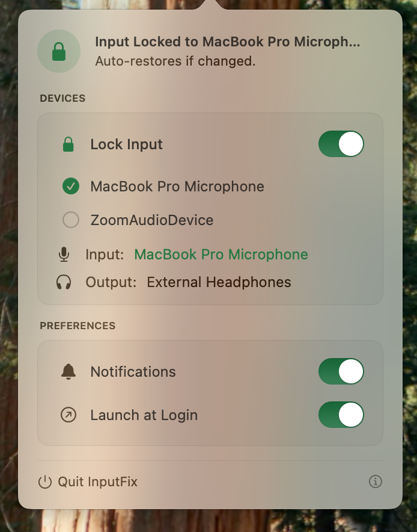

# InputFix

A lightweight macOS menu bar utility that prevents unwanted microphone input switching. When AirPods connect or another device tries to hijack your mic, InputFix automatically switches back to your preferred input device.

<p align="center">
  
</p>

## Features

- **Lock Input** — Locks input to your preferred microphone and auto-reverts if another device takes over
- **Restore Counter** — Tracks how many times InputFix has auto-restored your preferred device
- **Manual Fix** — One-click "Fix Mic Now" button to instantly revert input
- **Disconnect on Display Sleep** — Releases a chosen Bluetooth device (e.g. earbuds) the moment the display sleeps, so your phone/tablet can grab it; reconnects it on wake
- **Notifications** — Alerts when a mic switch is detected and corrected, and when the Bluetooth device is released/reconnected
- **Launch at Login** — Start automatically via macOS Login Items
- **Light & Dark Mode** — Adaptive UI with status-colored accents (green = locked, orange = unlocked)

## Requirements

- macOS 14.0+ (Sonoma)
- Xcode 15.0+

No external dependencies. Uses CoreAudio, IOBluetooth, ServiceManagement, and UserNotifications frameworks.

## Build & Run

### Xcode

Open `InputFix.xcodeproj` and press **Cmd+R**.

### Terminal

```bash
xcodebuild -project InputFix.xcodeproj -scheme InputFix -configuration Debug SYMROOT="$(pwd)/build" build
open build/Debug/InputFix.app
```

## How It Works

1. InputFix lives in the menu bar (no Dock icon)
2. Click the status icon to open the popover
3. Select your preferred input device from the picker
4. Enable **Lock Input**
5. When another device tries to claim the input (e.g., AirPods connecting), InputFix detects the change via CoreAudio listeners and switches back automatically

For the Bluetooth release: pick a paired device in the BLUETOOTH section and enable **Disconnect on Display Sleep**. InputFix watches the macOS unified log for the system's own display power events (`com.apple.SkyLight:display` — `Event: Did Sleep` / `Event: Did Wake`), disconnects the device via IOBluetooth when the screen goes black, and reconnects it when the display wakes. This is event-driven — no polling, no idle-time heuristics, and no false positives when an app (video, download) keeps your display awake. Only the selected device is touched; keyboard and mouse are left alone. Turn off **Reconnect on Wake** if you'd rather let your phone keep the earbuds.

Settings are persisted via UserDefaults.

## Project Structure

```
InputFix/
├── InputFixApp.swift          # App entry, status bar & popover setup
├── AudioDeviceManager.swift   # CoreAudio device control & auto-lock logic
├── BluetoothManager.swift     # Display-sleep watcher & Bluetooth release logic
├── NotificationService.swift  # Shared notification dispatch
├── PopoverView.swift          # Main UI container & Fix Mic button
├── StatusHeaderView.swift     # Lock status header
├── DeviceInfoCard.swift       # Current input/output device display
├── DevicePickerView.swift     # Generic device selector (audio & Bluetooth)
├── SettingsCard.swift         # DevicesCard, BluetoothCard & PreferencesCard
├── SettingsToggleRow.swift    # Reusable toggle row component
├── Theme.swift                # Design tokens (colors, fonts, spacing)
├── FooterView.swift           # Quit button & version
└── SectionDivider.swift       # Section divider component
```
